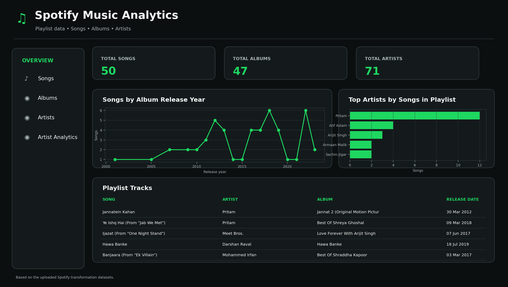
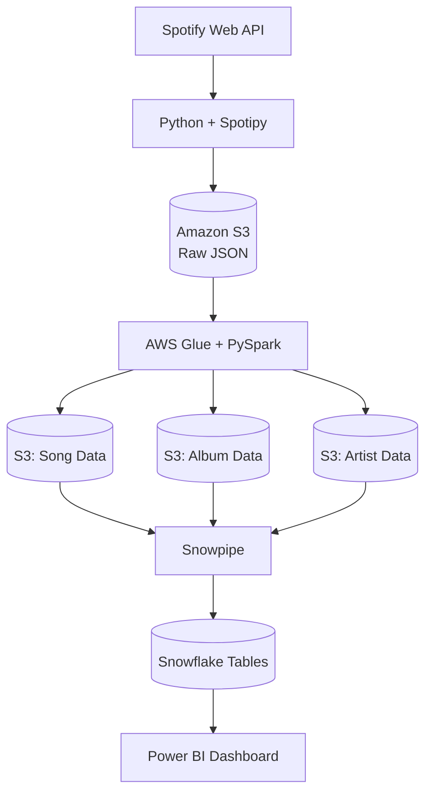

# 🎧 Spotify Data Engineering Pipeline

An end-to-end data engineering project that extracts Spotify music data, transforms it using PySpark on AWS Glue, stores it in Amazon S3, and loads it into Snowflake for analytics and visualization using Power BI.

## 📌 Overview

This project automates the journey of Spotify data from extraction to analytics. Music metadata is collected through the Spotify Web API using Python and Spotipy, stored as raw JSON in Amazon S3, and transformed into structured datasets using AWS Glue and PySpark.

The transformed song, album, and artist datasets are stored in S3 and loaded into Snowflake using Snowpipe for downstream analysis and reporting.

## 📊 Power BI Dashboard

Connected Snowflake with Power BI to explore the Spotify data. Created visualizations using the songs, albums, and artists datasets.



### Overview

Provides a consolidated view of Spotify music data.

### Songs Analysis

Explore song-level information and metadata.

### Album Analysis

Analyze album details, release dates, and track information.

### Artist Analysis

Explore artist information and associated music data.

## 🏗️ Architecture



## ⚙️ Data Pipeline

1. **Data Extraction:** Python and Spotipy authenticate with Spotify and retrieve playlist data through the Spotify Web API.
2. **Raw Data Storage:** Extracted JSON data is stored in Amazon S3.
3. **Data Transformation:** AWS Glue with PySpark processes nested JSON structures and extracts song, album, and artist information.
4. **Curated Data Storage:** Transformed datasets are written as CSV files to separate S3 prefixes.
5. **Data Loading:** Snowflake storage integration and external staging provide access to S3 data. Snowpipe with auto-ingestion is configured using S3 event notifications.
6. **Analytics:** Snowflake tables serve as the data source for Power BI reporting.

## ☁️ AWS S3 Data Layout

```text
spotify-etl-project-gaurav-ambasta/
├── raw_data/
│   └── to_processed/
    └── processed/
└── transformed_data/
    ├── song_data/
    ├── album_data/
    └── artist_data/
```

## ❄️ Snowflake Data Model

Database: `SPOTIFY_MUSIC_DB`  
Schema: `PUBLIC`

| Table       | Description            |
| ----------- | ---------------------- |
| `TBLSONGS`  | Song-level information |
| `TBLALBUM`  | Album metadata         |
| `TBLARTIST` | Artist information     |

## ✨ Key Features

- Spotify data extraction using Python and Spotipy.
- Distributed data transformation using AWS Glue and PySpark.
- Raw and transformed data storage in Amazon S3.
- Automated ingestion setup using Snowpipe and S3 event notifications.
- Snowflake integration for structured data storage and analytics.
- Power BI integration for data visualization.

## 🧰 Technology Stack

| Category        | Technologies                     |
| --------------- | -------------------------------- |
| Programming     | Python                           |
| Data Source     | Spotify Web API, Spotipy         |
| Cloud Storage   | Amazon S3                        |
| Data Processing | AWS Glue, PySpark                |
| Cloud Security  | AWS IAM                          |
| Data Warehouse  | Snowflake                        |
| Data Ingestion  | Snowpipe, S3 Event Notifications |
| Visualization   | Power BI                         |
| Query Language  | SQL                              |
